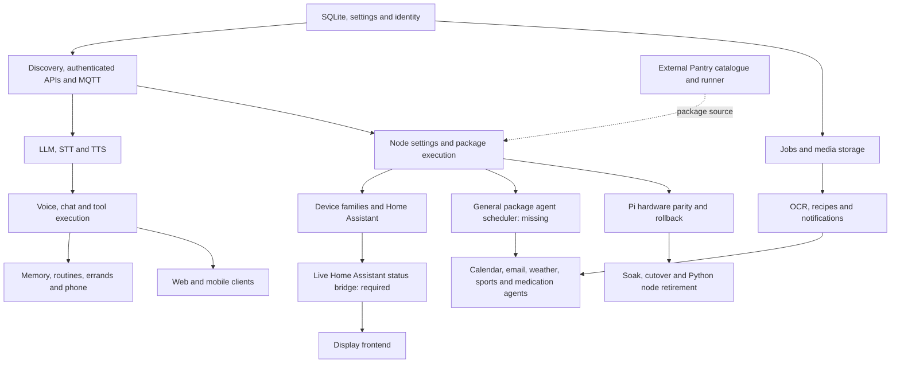
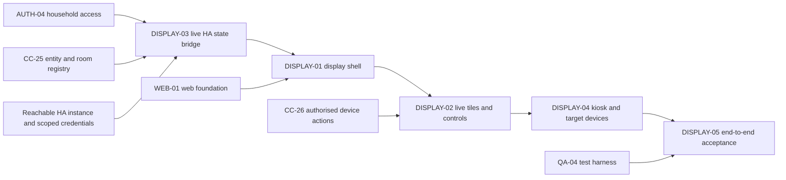
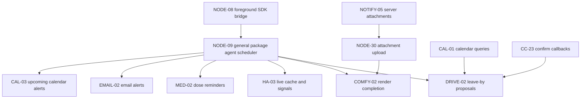

# Feature dependencies and migration order

[Tracker](Get-Migration-Tracker.md) | [Repository snapshot](Get-Repository-Inventory.md)

An arrow means the prerequisite capability must be available before the dependent feature can be accepted. Existing complete prerequisites need no reimplementation. Edges are planning dependencies derived from source consumers and runtime boundaries, not an exhaustive package/import graph. External services and credentials are listed separately.

## Consolidation map

The overview groups logical capabilities. The exact predecessor IDs below are authoritative; for example the new display can use an HA event bridge without waiting for every Pi device protocol or package agent to migrate.

## Recommended remaining work

1. Preserve the implemented server core and reproduce its relevant contract checks before cutover. Do not repeat already completed ports.
2. Complete node runtime gaps: settings/secret parity, the three skipped voice commands, general background agent scheduling, and inbox attachment upload. These unlock many command packages at once.
3. Verify each command/device integration against its actual service or hardware. Foreground execution does not prove its background agents, callbacks or rich inbox output.
4. Build the mandatory live Home Assistant bridge and the Display frontend together, after identity and entity registry boundaries are settled. This track can run independently of camera streaming, telephony and LLM engine expansion.
5. Close Pi acoustic/calibration gaps, on-device provisioning/reset/update rollback, and the 24-hour soak before proposing retirement of the Python node.
6. Finish native client acceptance, installer clean-machine sign-off, public documentation and the release transition. Keep Pantry as an external service.

## Display frontend dependency map

Mandatory acceptance: a Home Assistant device changed outside Jarvis updates the dashboard live; control feedback reflects the resulting authoritative state; disconnected/stale entities are labelled; reconnect refreshes the snapshot; household boundaries hold; the flow works on a Pi with an external screen, a Surface-style device and an Android tablet. Browser delivery is a proposal, not a user requirement for a new native application.

The existing [home-state event decision](../decisions/2026-10-14-home-state-reaches-watches-as-node-signals.md) governs watches. Reuse that event path where suitable, but do not mark the new display bridge complete merely because a device.state signal or a state-query API exists.

## Package dependency examples

## External prerequisites

These are runtime requirements, not repositories to move into jarvisd. Provider availability, credentials and entitlements were not tested.

| Feature family              | External requirement                                                                                      |
| --------------------------- | --------------------------------------------------------------------------------------------------------- |
| Display / Home Assistant    | Reachable Home Assistant instance, permitted entities, authenticated state-event feed and action API.     |
| Package installation        | Public or private Pantry/repository access and pinned Python SDK/runtime while bridging remains.          |
| Cloud notifications / OAuth | Reachable production relay and Expo/APNs/FCM; public OAuth bounce where configured.                       |
| Phone                       | Twilio account/number, household credentials and reachable signed webhook/media endpoint.                 |
| Messages                    | macOS host, jarvis-osx-api, Messages/Contacts permissions and scoped key.                                 |
| Calendar / email / travel   | CalDAV/Google/IMAP/SMTP credentials and Google Maps where selected.                                       |
| Music / radio               | Music Assistant/AirPlay, mpd, Pandora player or Spotify/go-librespot, plus real audio output.             |
| Device families             | Vendor account/bridge/hub plus actual devices; LAN, Bluetooth, HAP or Z-Wave connectivity as appropriate. |
| Vision / inference          | Correct models and engines, sufficient memory, platform accelerators and required native libraries.       |
| Pi retirement               | Lab Pi, microphone/HAT, Bluetooth devices, failure/rollback rehearsal and a 24-hour soak.                 |

## Exact predecessor ledger

No cycles or unknown IDs are permitted. Each level is one greater than its highest prerequisite level; independent rows in a level can proceed in parallel once their prerequisites are available. These are dependency levels, not dates or effort estimates. Cuts and external-only rows are included for traceability and are not automatically work to schedule.

### Dependency level 0

- [ADMIN-07](Get-Operations-Features.md#admin-07): no in-inventory prerequisites. Status: not started.
- [CC-35](Get-Orchestration-Features.md#cc-35): no in-inventory prerequisites. Status: not started.
- [CC-36](Get-Orchestration-Features.md#cc-36): no in-inventory prerequisites. Status: not started.
- [CC-39](Get-Orchestration-Features.md#cc-39): no in-inventory prerequisites. Status: not started.
- [CC-40](Get-Orchestration-Features.md#cc-40): no in-inventory prerequisites. Status: not started.
- [CC-41](Get-Orchestration-Features.md#cc-41): no in-inventory prerequisites. Status: not started.
- [DOCS-03](Get-Operations-Features.md#docs-03): no in-inventory prerequisites. Status: not started.
- [HERMES-01](Get-Orchestration-Features.md#hermes-01): no in-inventory prerequisites. Status: not started.
- [INSTALL-02](Get-Operations-Features.md#install-02): no in-inventory prerequisites. Status: not started.
- [LLM-15](Get-Services-Features.md#llm-15): no in-inventory prerequisites. Status: not started.
- [LLM-16](Get-Services-Features.md#llm-16): no in-inventory prerequisites. Status: not started.
- [LOG-04](Get-Foundations-Features.md#log-04): no in-inventory prerequisites. Status: not started.
- [LOOP-01](Get-External-Features.md#loop-01): no in-inventory prerequisites. Status: not started.
- [MCP-01](Get-Orchestration-Features.md#mcp-01): no in-inventory prerequisites. Status: not started.
- [MISTRAL-01](Get-Orchestration-Features.md#mistral-01): no in-inventory prerequisites. Status: not started.
- [MOB-14](Get-Clients-Features.md#mob-14): no in-inventory prerequisites. Status: not started.
- [NODE-29](Get-Nodes-Features.md#node-29): no in-inventory prerequisites. Status: not started.
- [OCR-04](Get-Services-Features.md#ocr-04): no in-inventory prerequisites. Status: not started.
- [OPS-06](Get-Operations-Features.md#ops-06): no in-inventory prerequisites. Status: not started.
- [PANTRY-01](Get-Pantry-Features.md#pantry-01): no in-inventory prerequisites. Status: not applicable.
- [PLAT-01](Get-Foundations-Features.md#plat-01): no in-inventory prerequisites. Status: complete.
- [PLAT-04](Get-Foundations-Features.md#plat-04): no in-inventory prerequisites. Status: not started.
- [RELAY-02](Get-External-Features.md#relay-02): no in-inventory prerequisites. Status: not started.
- [SCRAPE-02](Get-Foundations-Features.md#scrape-02): no in-inventory prerequisites. Status: complete.
- [SDK-07](Get-Nodes-Features.md#sdk-07): no in-inventory prerequisites. Status: not started.
- [STT-04](Get-Services-Features.md#stt-04): no in-inventory prerequisites. Status: not started.
- [TTS-03](Get-Services-Features.md#tts-03): no in-inventory prerequisites. Status: not started.

### Dependency level 1

- [AUTH-01](Get-Foundations-Features.md#auth-01): [PLAT-01](Get-Foundations-Features.md#plat-01). Status: complete.
- [CONF-01](Get-Foundations-Features.md#conf-01): [PLAT-01](Get-Foundations-Features.md#plat-01). Status: complete.
- [LOOP-03](Get-External-Features.md#loop-03): [LOOP-01](Get-External-Features.md#loop-01). Status: not started.
- [LOOP-04](Get-External-Features.md#loop-04): [LOOP-01](Get-External-Features.md#loop-01). Status: not started.
- [MCP-02](Get-Orchestration-Features.md#mcp-02): [MCP-01](Get-Orchestration-Features.md#mcp-01). Status: not started.
- [MCP-03](Get-Orchestration-Features.md#mcp-03): [MCP-01](Get-Orchestration-Features.md#mcp-01). Status: not started.
- [PANTRY-02](Get-Pantry-Features.md#pantry-02): [PANTRY-01](Get-Pantry-Features.md#pantry-01). Status: not applicable.
- [PANTRY-03](Get-Pantry-Features.md#pantry-03): [PANTRY-01](Get-Pantry-Features.md#pantry-01). Status: not applicable.
- [PANTRY-06](Get-Pantry-Features.md#pantry-06): [PANTRY-01](Get-Pantry-Features.md#pantry-01). Status: not applicable.
- [PLAT-02](Get-Foundations-Features.md#plat-02): [PLAT-01](Get-Foundations-Features.md#plat-01). Status: complete.
- [PLAT-03](Get-Foundations-Features.md#plat-03): [PLAT-01](Get-Foundations-Features.md#plat-01). Status: complete.
- [SET-01](Get-Foundations-Features.md#set-01): [PLAT-01](Get-Foundations-Features.md#plat-01). Status: complete.

### Dependency level 2

- [AUTH-02](Get-Foundations-Features.md#auth-02): [AUTH-01](Get-Foundations-Features.md#auth-01). Status: complete.
- [AUTH-03](Get-Foundations-Features.md#auth-03): [AUTH-01](Get-Foundations-Features.md#auth-01). Status: complete.
- [AUTH-04](Get-Foundations-Features.md#auth-04): [AUTH-01](Get-Foundations-Features.md#auth-01). Status: complete.
- [AUTH-05](Get-Foundations-Features.md#auth-05): [AUTH-01](Get-Foundations-Features.md#auth-01). Status: complete.
- [AUTH-08](Get-Foundations-Features.md#auth-08): [AUTH-01](Get-Foundations-Features.md#auth-01). Status: complete.
- [CONF-02](Get-Foundations-Features.md#conf-02): [CONF-01](Get-Foundations-Features.md#conf-01). Status: complete.
- [CONFLIB-01](Get-Foundations-Features.md#conflib-01): [CONF-01](Get-Foundations-Features.md#conf-01). Status: complete.
- [OPS-01](Get-Operations-Features.md#ops-01): [CONF-01](Get-Foundations-Features.md#conf-01), [AUTH-01](Get-Foundations-Features.md#auth-01). Status: complete.
- [PANTRY-04](Get-Pantry-Features.md#pantry-04): [PANTRY-02](Get-Pantry-Features.md#pantry-02). Status: not applicable.
- [PWEB-01](Get-Pantry-Features.md#pweb-01): [PANTRY-01](Get-Pantry-Features.md#pantry-01), [PANTRY-03](Get-Pantry-Features.md#pantry-03). Status: not applicable.
- [PWEB-04](Get-Pantry-Features.md#pweb-04): [PANTRY-06](Get-Pantry-Features.md#pantry-06). Status: not applicable.
- [RPROTO-01](Get-Clients-Features.md#rproto-01): [AUTH-01](Get-Foundations-Features.md#auth-01). Status: complete.
- [SCRAPE-01](Get-Foundations-Features.md#scrape-01): [CONF-01](Get-Foundations-Features.md#conf-01). Status: complete.

### Dependency level 3

- [AUTH-06](Get-Foundations-Features.md#auth-06): [AUTH-04](Get-Foundations-Features.md#auth-04). Status: complete.
- [AUTH-07](Get-Foundations-Features.md#auth-07): [AUTH-04](Get-Foundations-Features.md#auth-04), [AUTH-05](Get-Foundations-Features.md#auth-05). Status: complete.
- [AUTHLIB-01](Get-Foundations-Features.md#authlib-01): [AUTH-05](Get-Foundations-Features.md#auth-05), [AUTH-08](Get-Foundations-Features.md#auth-08). Status: complete.
- [CONF-03](Get-Foundations-Features.md#conf-03): [CONF-01](Get-Foundations-Features.md#conf-01), [AUTH-05](Get-Foundations-Features.md#auth-05). Status: complete.
- [CONFLIB-02](Get-Foundations-Features.md#conflib-02): [CONF-02](Get-Foundations-Features.md#conf-02). Status: complete.
- [LLM-01](Get-Services-Features.md#llm-01): [AUTH-05](Get-Foundations-Features.md#auth-05), [SET-01](Get-Foundations-Features.md#set-01). Status: complete.
- [MOB-01](Get-Clients-Features.md#mob-01): [CONF-02](Get-Foundations-Features.md#conf-02), [AUTH-03](Get-Foundations-Features.md#auth-03). Status: in progress.
- [NOTIFY-01](Get-Services-Features.md#notify-01): [AUTH-04](Get-Foundations-Features.md#auth-04), [PLAT-01](Get-Foundations-Features.md#plat-01). Status: complete.
- [NOTIFY-03](Get-Services-Features.md#notify-03): [AUTH-04](Get-Foundations-Features.md#auth-04), [PLAT-01](Get-Foundations-Features.md#plat-01). Status: complete.
- [OCR-01](Get-Services-Features.md#ocr-01): [PLAT-02](Get-Foundations-Features.md#plat-02), [AUTH-05](Get-Foundations-Features.md#auth-05). Status: complete.
- [OPS-02](Get-Operations-Features.md#ops-02): [OPS-01](Get-Operations-Features.md#ops-01), [PLAT-01](Get-Foundations-Features.md#plat-01). Status: complete.
- [OSX-01](Get-External-Features.md#osx-01): [AUTH-05](Get-Foundations-Features.md#auth-05). Status: not started.
- [PANTRY-05](Get-Pantry-Features.md#pantry-05): [PANTRY-04](Get-Pantry-Features.md#pantry-04). Status: not applicable.
- [PANTRY-07](Get-Pantry-Features.md#pantry-07): [PANTRY-04](Get-Pantry-Features.md#pantry-04). Status: not applicable.
- [PRUN-01](Get-Pantry-Features.md#prun-01): [PANTRY-04](Get-Pantry-Features.md#pantry-04). Status: not applicable.
- [PWEB-02](Get-Pantry-Features.md#pweb-02): [PANTRY-04](Get-Pantry-Features.md#pantry-04). Status: not applicable.
- [RECIPE-01](Get-Services-Features.md#recipe-01): [AUTH-04](Get-Foundations-Features.md#auth-04), [PLAT-01](Get-Foundations-Features.md#plat-01). Status: complete.
- [RPROTO-02](Get-Clients-Features.md#rproto-02): [RPROTO-01](Get-Clients-Features.md#rproto-01). Status: in progress.
- [SET-02](Get-Foundations-Features.md#set-02): [SET-01](Get-Foundations-Features.md#set-01), [AUTH-08](Get-Foundations-Features.md#auth-08). Status: complete.
- [TTS-01](Get-Services-Features.md#tts-01): [AUTH-05](Get-Foundations-Features.md#auth-05), [SET-01](Get-Foundations-Features.md#set-01). Status: complete.

### Dependency level 4

- [ADMIN-06](Get-Operations-Features.md#admin-06): [OPS-02](Get-Operations-Features.md#ops-02). Status: complete.
- [AUTHLIB-02](Get-Foundations-Features.md#authlib-02): [AUTHLIB-01](Get-Foundations-Features.md#authlib-01). Status: complete.
- [CC-01](Get-Orchestration-Features.md#cc-01): [AUTH-06](Get-Foundations-Features.md#auth-06), [CONF-01](Get-Foundations-Features.md#conf-01). Status: complete.
- [CONF-04](Get-Foundations-Features.md#conf-04): [SET-01](Get-Foundations-Features.md#set-01), [AUTH-07](Get-Foundations-Features.md#auth-07). Status: complete.
- [CONF-05](Get-Foundations-Features.md#conf-05): [CONF-03](Get-Foundations-Features.md#conf-03), [AUTH-05](Get-Foundations-Features.md#auth-05). Status: in progress.
- [LLM-02](Get-Services-Features.md#llm-02): [LLM-01](Get-Services-Features.md#llm-01). Status: complete.
- [LLM-03](Get-Services-Features.md#llm-03): [LLM-01](Get-Services-Features.md#llm-01). Status: complete.
- [LLM-07](Get-Services-Features.md#llm-07): [LLM-01](Get-Services-Features.md#llm-01). Status: complete.
- [LLM-08](Get-Services-Features.md#llm-08): [LLM-01](Get-Services-Features.md#llm-01), [PLAT-02](Get-Foundations-Features.md#plat-02). Status: complete.
- [LLM-09](Get-Services-Features.md#llm-09): [LLM-01](Get-Services-Features.md#llm-01). Status: complete.
- [LLM-10](Get-Services-Features.md#llm-10): [LLM-01](Get-Services-Features.md#llm-01). Status: complete.
- [LLM-14](Get-Services-Features.md#llm-14): [LLM-01](Get-Services-Features.md#llm-01). Status: complete.
- [LOG-01](Get-Foundations-Features.md#log-01): [PLAT-01](Get-Foundations-Features.md#plat-01), [AUTH-05](Get-Foundations-Features.md#auth-05), [AUTH-06](Get-Foundations-Features.md#auth-06). Status: complete.
- [MOB-13](Get-Clients-Features.md#mob-13): [MOB-01](Get-Clients-Features.md#mob-01). Status: not started.
- [NOTIFY-02](Get-Services-Features.md#notify-02): [NOTIFY-01](Get-Services-Features.md#notify-01). Status: complete.
- [NOTIFY-04](Get-Services-Features.md#notify-04): [NOTIFY-03](Get-Services-Features.md#notify-03), [PLAT-02](Get-Foundations-Features.md#plat-02). Status: complete.
- [NOTIFY-05](Get-Services-Features.md#notify-05): [NOTIFY-03](Get-Services-Features.md#notify-03), [PLAT-03](Get-Foundations-Features.md#plat-03). Status: complete.
- [OSX-02](Get-External-Features.md#osx-02): [OSX-01](Get-External-Features.md#osx-01). Status: not started.
- [OSX-04](Get-External-Features.md#osx-04): [OSX-01](Get-External-Features.md#osx-01). Status: not started.
- [PRUN-02](Get-Pantry-Features.md#prun-02): [PRUN-01](Get-Pantry-Features.md#prun-01). Status: not applicable.
- [PWEB-03](Get-Pantry-Features.md#pweb-03): [PANTRY-05](Get-Pantry-Features.md#pantry-05). Status: not applicable.
- [RECIPE-02](Get-Services-Features.md#recipe-02): [RECIPE-01](Get-Services-Features.md#recipe-01). Status: complete.
- [RECIPE-03](Get-Services-Features.md#recipe-03): [RECIPE-01](Get-Services-Features.md#recipe-01), [LLM-01](Get-Services-Features.md#llm-01), [SCRAPE-02](Get-Foundations-Features.md#scrape-02). Status: complete.
- [RECIPE-07](Get-Services-Features.md#recipe-07): [RECIPE-01](Get-Services-Features.md#recipe-01). Status: complete.
- [RECIPE-10](Get-Services-Features.md#recipe-10): [RECIPE-01](Get-Services-Features.md#recipe-01), [PLAT-03](Get-Foundations-Features.md#plat-03). Status: complete.
- [RECIPE-11](Get-Services-Features.md#recipe-11): [RECIPE-01](Get-Services-Features.md#recipe-01). Status: complete.
- [RELAY-03](Get-External-Features.md#relay-03): [MOB-01](Get-Clients-Features.md#mob-01). Status: not started.
- [RMOB-01](Get-Clients-Features.md#rmob-01): [AUTH-03](Get-Foundations-Features.md#auth-03), [RECIPE-01](Get-Services-Features.md#recipe-01). Status: in progress.
- [TTS-02](Get-Services-Features.md#tts-02): [TTS-01](Get-Services-Features.md#tts-01). Status: complete.

### Dependency level 5

- [ADMIN-01](Get-Operations-Features.md#admin-01): [AUTH-07](Get-Foundations-Features.md#auth-07), [CONF-03](Get-Foundations-Features.md#conf-03), [CC-01](Get-Orchestration-Features.md#cc-01). Status: complete.
- [ADMIN-02](Get-Operations-Features.md#admin-02): [CONF-04](Get-Foundations-Features.md#conf-04), [SET-02](Get-Foundations-Features.md#set-02). Status: in progress.
- [CC-02](Get-Orchestration-Features.md#cc-02): [CC-01](Get-Orchestration-Features.md#cc-01). Status: complete.
- [CC-14](Get-Orchestration-Features.md#cc-14): [AUTH-04](Get-Foundations-Features.md#auth-04), [LLM-07](Get-Services-Features.md#llm-07), [PLAT-01](Get-Foundations-Features.md#plat-01). Status: complete.
- [DOCS-04](Get-Operations-Features.md#docs-04): [MOB-13](Get-Clients-Features.md#mob-13). Status: not started.
- [LLM-04](Get-Services-Features.md#llm-04): [LLM-03](Get-Services-Features.md#llm-03). Status: complete.
- [LLM-05](Get-Services-Features.md#llm-05): [LLM-03](Get-Services-Features.md#llm-03). Status: complete.
- [LOG-02](Get-Foundations-Features.md#log-02): [LOG-01](Get-Foundations-Features.md#log-01). Status: complete.
- [LOG-03](Get-Foundations-Features.md#log-03): [LOG-01](Get-Foundations-Features.md#log-01), [PLAT-02](Get-Foundations-Features.md#plat-02). Status: complete.
- [LOGLIB-01](Get-Foundations-Features.md#loglib-01): [LOG-01](Get-Foundations-Features.md#log-01). Status: complete.
- [OCR-02](Get-Services-Features.md#ocr-02): [OCR-01](Get-Services-Features.md#ocr-01), [LLM-10](Get-Services-Features.md#llm-10), [SCRAPE-02](Get-Foundations-Features.md#scrape-02). Status: complete.
- [OSX-03](Get-External-Features.md#osx-03): [OSX-02](Get-External-Features.md#osx-02). Status: not started.
- [RECIPE-06](Get-Services-Features.md#recipe-06): [RECIPE-01](Get-Services-Features.md#recipe-01), [LLM-08](Get-Services-Features.md#llm-08). Status: complete.
- [RECIPE-08](Get-Services-Features.md#recipe-08): [RECIPE-02](Get-Services-Features.md#recipe-02), [RECIPE-07](Get-Services-Features.md#recipe-07). Status: complete.
- [RELAY-01](Get-External-Features.md#relay-01): [NOTIFY-02](Get-Services-Features.md#notify-02). Status: in progress.
- [SETOLD-01](Get-Foundations-Features.md#setold-01): [CONF-04](Get-Foundations-Features.md#conf-04). Status: complete.

### Dependency level 6

- [CC-03](Get-Orchestration-Features.md#cc-03): [LLM-01](Get-Services-Features.md#llm-01), [TTS-01](Get-Services-Features.md#tts-01), [CC-02](Get-Orchestration-Features.md#cc-02). Status: complete.
- [CC-15](Get-Orchestration-Features.md#cc-15): [CC-14](Get-Orchestration-Features.md#cc-14), [LLM-08](Get-Services-Features.md#llm-08). Status: complete.
- [CC-22](Get-Orchestration-Features.md#cc-22): [CC-02](Get-Orchestration-Features.md#cc-02), [PLAT-02](Get-Foundations-Features.md#plat-02). Status: complete.
- [CC-25](Get-Orchestration-Features.md#cc-25): [AUTH-04](Get-Foundations-Features.md#auth-04), [CC-02](Get-Orchestration-Features.md#cc-02). Status: complete.
- [CC-28](Get-Orchestration-Features.md#cc-28): [CC-02](Get-Orchestration-Features.md#cc-02). Status: complete.
- [CC-29](Get-Orchestration-Features.md#cc-29): [CC-02](Get-Orchestration-Features.md#cc-02), [AUTH-04](Get-Foundations-Features.md#auth-04). Status: complete.
- [CC-30](Get-Orchestration-Features.md#cc-30): [CC-02](Get-Orchestration-Features.md#cc-02), [AUTH-04](Get-Foundations-Features.md#auth-04). Status: complete.
- [CC-31](Get-Orchestration-Features.md#cc-31): [CC-02](Get-Orchestration-Features.md#cc-02), [AUTH-04](Get-Foundations-Features.md#auth-04). Status: complete.
- [LLM-06](Get-Services-Features.md#llm-06): [LLM-05](Get-Services-Features.md#llm-05), [PLAT-02](Get-Foundations-Features.md#plat-02). Status: complete.
- [NODE-01](Get-Nodes-Features.md#node-01): [CC-01](Get-Orchestration-Features.md#cc-01), [CC-02](Get-Orchestration-Features.md#cc-02), [CONFLIB-02](Get-Foundations-Features.md#conflib-02). Status: complete.
- [OCR-03](Get-Services-Features.md#ocr-03): [OCR-02](Get-Services-Features.md#ocr-02). Status: complete.
- [RECIPE-09](Get-Services-Features.md#recipe-09): [RECIPE-08](Get-Services-Features.md#recipe-08), [LLM-08](Get-Services-Features.md#llm-08). Status: complete.
- [RMOB-03](Get-Clients-Features.md#rmob-03): [RECIPE-06](Get-Services-Features.md#recipe-06), [RECIPE-07](Get-Services-Features.md#recipe-07). Status: in progress.
- [SETOLD-02](Get-Foundations-Features.md#setold-02): [SETOLD-01](Get-Foundations-Features.md#setold-01). Status: not started.

### Dependency level 7

- [ADMIN-03](Get-Operations-Features.md#admin-03): [AUTH-01](Get-Foundations-Features.md#auth-01), [LLM-06](Get-Services-Features.md#llm-06). Status: complete.
- [CC-23](Get-Orchestration-Features.md#cc-23): [CC-22](Get-Orchestration-Features.md#cc-22), [LLM-08](Get-Services-Features.md#llm-08), [NOTIFY-03](Get-Services-Features.md#notify-03). Status: complete.
- [CC-26](Get-Orchestration-Features.md#cc-26): [CC-25](Get-Orchestration-Features.md#cc-25). Status: complete.
- [CC-32](Get-Orchestration-Features.md#cc-32): [CC-02](Get-Orchestration-Features.md#cc-02), [NOTIFY-03](Get-Services-Features.md#notify-03), [LLM-01](Get-Services-Features.md#llm-01), [CC-22](Get-Orchestration-Features.md#cc-22). Status: complete.
- [CC-38](Get-Orchestration-Features.md#cc-38): [CC-30](Get-Orchestration-Features.md#cc-30). Status: complete.
- [DESK-01](Get-Nodes-Features.md#desk-01): [NODE-01](Get-Nodes-Features.md#node-01). Status: complete.
- [DISPLAY-03](Get-New-Features.md#display-03): [AUTH-04](Get-Foundations-Features.md#auth-04), [CC-25](Get-Orchestration-Features.md#cc-25). Status: not started.
- [LLM-11](Get-Services-Features.md#llm-11): [LLM-06](Get-Services-Features.md#llm-06). Status: in progress.
- [LLM-12](Get-Services-Features.md#llm-12): [LLM-06](Get-Services-Features.md#llm-06). Status: in progress.
- [LLM-13](Get-Services-Features.md#llm-13): [LLM-06](Get-Services-Features.md#llm-06). Status: in progress.
- [NODE-05](Get-Nodes-Features.md#node-05): [NODE-01](Get-Nodes-Features.md#node-01). Status: in progress.
- [NODE-06](Get-Nodes-Features.md#node-06): [NODE-01](Get-Nodes-Features.md#node-01), [CC-29](Get-Orchestration-Features.md#cc-29). Status: in progress.
- [OPS-05](Get-Operations-Features.md#ops-05): [LLM-06](Get-Services-Features.md#llm-06), [CONF-01](Get-Foundations-Features.md#conf-01). Status: not started.
- [RECIPE-04](Get-Services-Features.md#recipe-04): [RECIPE-01](Get-Services-Features.md#recipe-01), [OCR-03](Get-Services-Features.md#ocr-03), [PLAT-03](Get-Foundations-Features.md#plat-03). Status: complete.
- [RMOB-04](Get-Clients-Features.md#rmob-04): [RECIPE-09](Get-Services-Features.md#recipe-09). Status: in progress.
- [STT-01](Get-Services-Features.md#stt-01): [AUTH-05](Get-Foundations-Features.md#auth-05), [LLM-06](Get-Services-Features.md#llm-06). Status: complete.
- [TTS-04](Get-Services-Features.md#tts-04): [CC-03](Get-Orchestration-Features.md#cc-03). Status: not started.
- [WEB-03](Get-Clients-Features.md#web-03): [CC-30](Get-Orchestration-Features.md#cc-30), [CC-28](Get-Orchestration-Features.md#cc-28). Status: in progress.
- [WEB-04](Get-Clients-Features.md#web-04): [AUTH-04](Get-Foundations-Features.md#auth-04), [CC-25](Get-Orchestration-Features.md#cc-25). Status: not started.

### Dependency level 8

- [ADMIN-08](Get-Operations-Features.md#admin-08): [ADMIN-01](Get-Operations-Features.md#admin-01), [ADMIN-03](Get-Operations-Features.md#admin-03). Status: in progress.
- [CC-04](Get-Orchestration-Features.md#cc-04): [STT-01](Get-Services-Features.md#stt-01), [TTS-02](Get-Services-Features.md#tts-02), [LLM-02](Get-Services-Features.md#llm-02), [CC-02](Get-Orchestration-Features.md#cc-02). Status: complete.
- [CC-24](Get-Orchestration-Features.md#cc-24): [CC-23](Get-Orchestration-Features.md#cc-23), [NOTIFY-02](Get-Services-Features.md#notify-02). Status: complete.
- [CC-27](Get-Orchestration-Features.md#cc-27): [CC-26](Get-Orchestration-Features.md#cc-26). Status: not started.
- [DESK-02](Get-Nodes-Features.md#desk-02): [DESK-01](Get-Nodes-Features.md#desk-01). Status: complete.
- [DESK-04](Get-Nodes-Features.md#desk-04): [DESK-01](Get-Nodes-Features.md#desk-01). Status: complete.
- [INSTALL-01](Get-Operations-Features.md#install-01): [OPS-02](Get-Operations-Features.md#ops-02), [ADMIN-03](Get-Operations-Features.md#admin-03). Status: in progress.
- [INSTALL-03](Get-Operations-Features.md#install-03): [OPS-02](Get-Operations-Features.md#ops-02), [ADMIN-03](Get-Operations-Features.md#admin-03). Status: in progress.
- [MOB-03](Get-Clients-Features.md#mob-03): [NODE-05](Get-Nodes-Features.md#node-05), [DESK-01](Get-Nodes-Features.md#desk-01). Status: in progress.
- [MOB-07](Get-Clients-Features.md#mob-07): [NOTIFY-05](Get-Services-Features.md#notify-05), [CC-23](Get-Orchestration-Features.md#cc-23). Status: in progress.
- [MOB-09](Get-Clients-Features.md#mob-09): [CC-31](Get-Orchestration-Features.md#cc-31), [CC-29](Get-Orchestration-Features.md#cc-29), [CC-26](Get-Orchestration-Features.md#cc-26). Status: in progress.
- [NEW-02](Get-New-Features.md#new-02): [DESK-01](Get-Nodes-Features.md#desk-01). Status: complete.
- [NEW-04](Get-New-Features.md#new-04): [DESK-01](Get-Nodes-Features.md#desk-01), [AUTH-06](Get-Foundations-Features.md#auth-06). Status: in progress.
- [NODE-07](Get-Nodes-Features.md#node-07): [NODE-06](Get-Nodes-Features.md#node-06), [CC-30](Get-Orchestration-Features.md#cc-30). Status: in progress.
- [RECIPE-05](Get-Services-Features.md#recipe-05): [RECIPE-04](Get-Services-Features.md#recipe-04), [LLM-10](Get-Services-Features.md#llm-10). Status: complete.
- [RMOB-02](Get-Clients-Features.md#rmob-02): [RECIPE-03](Get-Services-Features.md#recipe-03), [RECIPE-04](Get-Services-Features.md#recipe-04). Status: in progress.
- [STT-02](Get-Services-Features.md#stt-02): [STT-01](Get-Services-Features.md#stt-01), [AUTH-04](Get-Foundations-Features.md#auth-04). Status: complete.
- [WEB-02](Get-Clients-Features.md#web-02): [NOTIFY-03](Get-Services-Features.md#notify-03), [CC-23](Get-Orchestration-Features.md#cc-23). Status: complete.

### Dependency level 9

- [CC-05](Get-Orchestration-Features.md#cc-05): [CC-04](Get-Orchestration-Features.md#cc-04). Status: complete.
- [CC-10](Get-Orchestration-Features.md#cc-10): [CC-04](Get-Orchestration-Features.md#cc-04). Status: complete.
- [CC-13](Get-Orchestration-Features.md#cc-13): [CC-04](Get-Orchestration-Features.md#cc-04), [PLAT-01](Get-Foundations-Features.md#plat-01). Status: complete.
- [DESK-03](Get-Nodes-Features.md#desk-03): [DESK-02](Get-Nodes-Features.md#desk-02). Status: complete.
- [JDT-03](Get-Operations-Features.md#jdt-03): [NODE-07](Get-Nodes-Features.md#node-07). Status: in progress.
- [MOB-06](Get-Clients-Features.md#mob-06): [CC-27](Get-Orchestration-Features.md#cc-27). Status: not started.
- [MOB-10](Get-Clients-Features.md#mob-10): [CC-30](Get-Orchestration-Features.md#cc-30), [CC-38](Get-Orchestration-Features.md#cc-38), [NODE-07](Get-Nodes-Features.md#node-07). Status: in progress.
- [MOB-12](Get-Clients-Features.md#mob-12): [CC-24](Get-Orchestration-Features.md#cc-24). Status: in progress.
- [NEW-01](Get-New-Features.md#new-01): [DESK-01](Get-Nodes-Features.md#desk-01), [CC-04](Get-Orchestration-Features.md#cc-04). Status: complete.
- [NODE-02](Get-Nodes-Features.md#node-02): [NODE-01](Get-Nodes-Features.md#node-01), [CC-04](Get-Orchestration-Features.md#cc-04). Status: in progress.
- [OPS-04](Get-Operations-Features.md#ops-04): [OPS-02](Get-Operations-Features.md#ops-02), [CC-04](Get-Orchestration-Features.md#cc-04). Status: in progress.
- [QA-01](Get-Operations-Features.md#qa-01): [CC-04](Get-Orchestration-Features.md#cc-04). Status: complete.
- [STT-03](Get-Services-Features.md#stt-03): [STT-02](Get-Services-Features.md#stt-02). Status: complete.

### Dependency level 10

- [ADMIN-05](Get-Operations-Features.md#admin-05): [LOG-02](Get-Foundations-Features.md#log-02), [CC-13](Get-Orchestration-Features.md#cc-13). Status: complete.
- [CC-06](Get-Orchestration-Features.md#cc-06): [CC-05](Get-Orchestration-Features.md#cc-05). Status: complete.
- [CC-07](Get-Orchestration-Features.md#cc-07): [LLM-03](Get-Services-Features.md#llm-03), [CC-05](Get-Orchestration-Features.md#cc-05). Status: complete.
- [CC-09](Get-Orchestration-Features.md#cc-09): [STT-03](Get-Services-Features.md#stt-03), [AUTH-04](Get-Foundations-Features.md#auth-04), [CC-04](Get-Orchestration-Features.md#cc-04). Status: complete.
- [CC-11](Get-Orchestration-Features.md#cc-11): [CC-05](Get-Orchestration-Features.md#cc-05), [AUTH-04](Get-Foundations-Features.md#auth-04). Status: complete.
- [CC-16](Get-Orchestration-Features.md#cc-16): [CC-05](Get-Orchestration-Features.md#cc-05), [SCRAPE-01](Get-Foundations-Features.md#scrape-01), [SCRAPE-02](Get-Foundations-Features.md#scrape-02). Status: complete.
- [CC-18](Get-Orchestration-Features.md#cc-18): [CC-05](Get-Orchestration-Features.md#cc-05), [CC-02](Get-Orchestration-Features.md#cc-02), [PLAT-01](Get-Foundations-Features.md#plat-01). Status: complete.
- [CC-20](Get-Orchestration-Features.md#cc-20): [CC-05](Get-Orchestration-Features.md#cc-05), [LLM-08](Get-Services-Features.md#llm-08), [NOTIFY-03](Get-Services-Features.md#notify-03). Status: complete.
- [CC-33](Get-Orchestration-Features.md#cc-33): [STT-03](Get-Services-Features.md#stt-03), [TTS-01](Get-Services-Features.md#tts-01), [CC-02](Get-Orchestration-Features.md#cc-02). Status: complete.
- [CC-37](Get-Orchestration-Features.md#cc-37): [CC-05](Get-Orchestration-Features.md#cc-05). Status: not started.
- [LOOP-02](Get-External-Features.md#loop-02): [QA-01](Get-Operations-Features.md#qa-01). Status: in progress.
- [NEW-03](Get-New-Features.md#new-03): [NEW-01](Get-New-Features.md#new-01), [NEW-02](Get-New-Features.md#new-02). Status: in progress.
- [NODE-03](Get-Nodes-Features.md#node-03): [NODE-02](Get-Nodes-Features.md#node-02), [CC-05](Get-Orchestration-Features.md#cc-05). Status: in progress.
- [NODE-04](Get-Nodes-Features.md#node-04): [NODE-02](Get-Nodes-Features.md#node-02). Status: in progress.
- [NODE-08](Get-Nodes-Features.md#node-08): [NODE-07](Get-Nodes-Features.md#node-07), [CC-05](Get-Orchestration-Features.md#cc-05). Status: in progress.
- [NODE-17](Get-Nodes-Features.md#node-17): [NODE-01](Get-Nodes-Features.md#node-01), [NODE-02](Get-Nodes-Features.md#node-02). Status: in progress.
- [NODE-20](Get-Nodes-Features.md#node-20): [NODE-02](Get-Nodes-Features.md#node-02). Status: not started.
- [NODE-22](Get-Nodes-Features.md#node-22): [NODE-02](Get-Nodes-Features.md#node-02), [CC-03](Get-Orchestration-Features.md#cc-03). Status: not started.
- [NODE-27](Get-Nodes-Features.md#node-27): [NODE-02](Get-Nodes-Features.md#node-02), [STT-03](Get-Services-Features.md#stt-03). Status: in progress.
- [NODE-31](Get-Nodes-Features.md#node-31): [NODE-02](Get-Nodes-Features.md#node-02). Status: not started.
- [QA-02](Get-Operations-Features.md#qa-02): [QA-01](Get-Operations-Features.md#qa-01), [LLM-01](Get-Services-Features.md#llm-01). Status: in progress.
- [QA-03](Get-Operations-Features.md#qa-03): [QA-01](Get-Operations-Features.md#qa-01). Status: in progress.
- [QA-04](Get-Operations-Features.md#qa-04): [QA-01](Get-Operations-Features.md#qa-01). Status: complete.

### Dependency level 11

- [ADMIN-04](Get-Operations-Features.md#admin-04): [LLM-06](Get-Services-Features.md#llm-06), [CC-07](Get-Orchestration-Features.md#cc-07). Status: complete.
- [BARSTOOL-01](Get-Packages-Features.md#barstool-01): [NODE-08](Get-Nodes-Features.md#node-08), [SCRAPE-02](Get-Foundations-Features.md#scrape-02). Status: in progress.
- [BT-01](Get-Packages-Features.md#bt-01): [NODE-08](Get-Nodes-Features.md#node-08), [NODE-17](Get-Nodes-Features.md#node-17). Status: in progress.
- [CC-08](Get-Orchestration-Features.md#cc-08): [CC-07](Get-Orchestration-Features.md#cc-07), [LLM-14](Get-Services-Features.md#llm-14). Status: complete.
- [CC-12](Get-Orchestration-Features.md#cc-12): [CC-11](Get-Orchestration-Features.md#cc-11), [LLM-10](Get-Services-Features.md#llm-10), [PLAT-03](Get-Foundations-Features.md#plat-03). Status: complete.
- [CC-17](Get-Orchestration-Features.md#cc-17): [CC-16](Get-Orchestration-Features.md#cc-16), [LLM-08](Get-Services-Features.md#llm-08), [NOTIFY-03](Get-Services-Features.md#notify-03). Status: complete.
- [CC-21](Get-Orchestration-Features.md#cc-21): [CC-20](Get-Orchestration-Features.md#cc-20). Status: complete.
- [CC-34](Get-Orchestration-Features.md#cc-34): [AUTH-04](Get-Foundations-Features.md#auth-04), [CC-20](Get-Orchestration-Features.md#cc-20), [NOTIFY-03](Get-Services-Features.md#notify-03). Status: complete.
- [DAD-01](Get-Packages-Features.md#dad-01): [NODE-08](Get-Nodes-Features.md#node-08). Status: in progress.
- [DRIVE-01](Get-Packages-Features.md#drive-01): [NODE-08](Get-Nodes-Features.md#node-08). Status: in progress.
- [EMAIL-01](Get-Packages-Features.md#email-01): [NODE-08](Get-Nodes-Features.md#node-08), [CC-23](Get-Orchestration-Features.md#cc-23). Status: in progress.
- [ENT-01](Get-Packages-Features.md#ent-01): [NODE-08](Get-Nodes-Features.md#node-08), [CC-23](Get-Orchestration-Features.md#cc-23). Status: in progress.
- [GREET-01](Get-Packages-Features.md#greet-01): [NODE-08](Get-Nodes-Features.md#node-08). Status: in progress.
- [LOGLIB-02](Get-Foundations-Features.md#loglib-02): [NODE-08](Get-Nodes-Features.md#node-08), [LOG-01](Get-Foundations-Features.md#log-01). Status: in progress.
- [MED-01](Get-Packages-Features.md#med-01): [NODE-08](Get-Nodes-Features.md#node-08), [CC-31](Get-Orchestration-Features.md#cc-31). Status: in progress.
- [MSG-01](Get-Packages-Features.md#msg-01): [NODE-08](Get-Nodes-Features.md#node-08), [OSX-02](Get-External-Features.md#osx-02). Status: in progress.
- [NEW-05](Get-New-Features.md#new-05): [CC-20](Get-Orchestration-Features.md#cc-20), [CC-22](Get-Orchestration-Features.md#cc-22), [SCRAPE-02](Get-Foundations-Features.md#scrape-02). Status: in progress.
- [NEW-07](Get-New-Features.md#new-07): [NEW-02](Get-New-Features.md#new-02), [NEW-03](Get-New-Features.md#new-03), [CC-20](Get-Orchestration-Features.md#cc-20). Status: in progress.
- [NEW-09](Get-New-Features.md#new-09): [CC-07](Get-Orchestration-Features.md#cc-07). Status: in progress.
- [NEWS-01](Get-Packages-Features.md#news-01): [NODE-08](Get-Nodes-Features.md#node-08), [CC-23](Get-Orchestration-Features.md#cc-23). Status: in progress.
- [NODE-09](Get-Nodes-Features.md#node-09): [NODE-08](Get-Nodes-Features.md#node-08). Status: not started.
- [NODE-10](Get-Nodes-Features.md#node-10): [NODE-08](Get-Nodes-Features.md#node-08), [TTS-01](Get-Services-Features.md#tts-01). Status: in progress.
- [NODE-11](Get-Nodes-Features.md#node-11): [NODE-08](Get-Nodes-Features.md#node-08), [NOTIFY-03](Get-Services-Features.md#notify-03). Status: in progress.
- [NODE-13](Get-Nodes-Features.md#node-13): [NODE-08](Get-Nodes-Features.md#node-08), [LLM-01](Get-Services-Features.md#llm-01). Status: in progress.
- [NODE-14](Get-Nodes-Features.md#node-14): [NODE-08](Get-Nodes-Features.md#node-08), [NODE-06](Get-Nodes-Features.md#node-06), [CC-31](Get-Orchestration-Features.md#cc-31). Status: in progress.
- [NODE-15](Get-Nodes-Features.md#node-15): [NODE-08](Get-Nodes-Features.md#node-08), [CC-18](Get-Orchestration-Features.md#cc-18), [CC-26](Get-Orchestration-Features.md#cc-26). Status: not started.
- [NODE-16](Get-Nodes-Features.md#node-16): [NODE-08](Get-Nodes-Features.md#node-08), [CC-26](Get-Orchestration-Features.md#cc-26). Status: in progress.
- [NODE-18](Get-Nodes-Features.md#node-18): [NODE-02](Get-Nodes-Features.md#node-02), [NODE-08](Get-Nodes-Features.md#node-08). Status: in progress.
- [NODE-21](Get-Nodes-Features.md#node-21): [NODE-20](Get-Nodes-Features.md#node-20). Status: not started.
- [NODE-23](Get-Nodes-Features.md#node-23): [NODE-04](Get-Nodes-Features.md#node-04), [NODE-05](Get-Nodes-Features.md#node-05). Status: in progress.
- [NODE-25](Get-Nodes-Features.md#node-25): [NODE-05](Get-Nodes-Features.md#node-05), [NODE-06](Get-Nodes-Features.md#node-06), [CC-18](Get-Orchestration-Features.md#cc-18). Status: in progress.
- [NODE-26](Get-Nodes-Features.md#node-26): [NODE-02](Get-Nodes-Features.md#node-02), [NODE-04](Get-Nodes-Features.md#node-04), [NODE-06](Get-Nodes-Features.md#node-06). Status: in progress.
- [NODE-30](Get-Nodes-Features.md#node-30): [NODE-08](Get-Nodes-Features.md#node-08), [NOTIFY-05](Get-Services-Features.md#notify-05). Status: not started.
- [OPS-03](Get-Operations-Features.md#ops-03): [AUTH-06](Get-Foundations-Features.md#auth-06), [CC-14](Get-Orchestration-Features.md#cc-14), [CC-18](Get-Orchestration-Features.md#cc-18), [NOTIFY-03](Get-Services-Features.md#notify-03). Status: complete.
- [RT-01](Get-Packages-Features.md#rt-01): [NODE-08](Get-Nodes-Features.md#node-08), [SCRAPE-02](Get-Foundations-Features.md#scrape-02). Status: in progress.
- [RTOLD-01](Get-Packages-Features.md#rtold-01): [NODE-08](Get-Nodes-Features.md#node-08), [SCRAPE-02](Get-Foundations-Features.md#scrape-02). Status: in progress.
- [SDK-01](Get-Nodes-Features.md#sdk-01): [NODE-08](Get-Nodes-Features.md#node-08). Status: in progress.
- [SDK-02](Get-Nodes-Features.md#sdk-02): [NODE-06](Get-Nodes-Features.md#node-06), [NODE-08](Get-Nodes-Features.md#node-08). Status: in progress.
- [SDK-03](Get-Nodes-Features.md#sdk-03): [NODE-08](Get-Nodes-Features.md#node-08). Status: in progress.
- [SDK-08](Get-Nodes-Features.md#sdk-08): [NODE-08](Get-Nodes-Features.md#node-08). Status: not started.
- [SEARCH-01](Get-Packages-Features.md#search-01): [NODE-08](Get-Nodes-Features.md#node-08), [CC-16](Get-Orchestration-Features.md#cc-16). Status: in progress.
- [WEB-01](Get-Clients-Features.md#web-01): [CC-11](Get-Orchestration-Features.md#cc-11). Status: complete.

### Dependency level 12

- [APPLE-01](Get-Devices-Features.md#apple-01): [NODE-16](Get-Nodes-Features.md#node-16), [CC-26](Get-Orchestration-Features.md#cc-26). Status: in progress.
- [AUDACY-01](Get-Packages-Features.md#audacy-01): [NODE-08](Get-Nodes-Features.md#node-08), [NODE-18](Get-Nodes-Features.md#node-18). Status: in progress.
- [CAL-01](Get-Packages-Features.md#cal-01): [NODE-08](Get-Nodes-Features.md#node-08), [CC-08](Get-Orchestration-Features.md#cc-08). Status: in progress.
- [CC-19](Get-Orchestration-Features.md#cc-19): [CC-18](Get-Orchestration-Features.md#cc-18), [PLAT-02](Get-Foundations-Features.md#plat-02), [CC-08](Get-Orchestration-Features.md#cc-08). Status: complete.
- [CC-42](Get-Orchestration-Features.md#cc-42): [CC-34](Get-Orchestration-Features.md#cc-34). Status: complete.
- [COMFY-01](Get-Packages-Features.md#comfy-01): [NODE-08](Get-Nodes-Features.md#node-08), [CC-12](Get-Orchestration-Features.md#cc-12). Status: in progress.
- [DISPLAY-01](Get-New-Features.md#display-01): [WEB-01](Get-Clients-Features.md#web-01), [AUTH-04](Get-Foundations-Features.md#auth-04), [DISPLAY-03](Get-New-Features.md#display-03). Status: not started.
- [DOCS-02](Get-Operations-Features.md#docs-02): [SDK-01](Get-Nodes-Features.md#sdk-01), [CC-32](Get-Orchestration-Features.md#cc-32). Status: in progress.
- [EMAIL-02](Get-Packages-Features.md#email-02): [EMAIL-01](Get-Packages-Features.md#email-01), [NODE-09](Get-Nodes-Features.md#node-09), [NOTIFY-03](Get-Services-Features.md#notify-03). Status: not started.
- [GOVEE-01](Get-Devices-Features.md#govee-01): [NODE-16](Get-Nodes-Features.md#node-16), [CC-26](Get-Orchestration-Features.md#cc-26). Status: in progress.
- [HA-01](Get-Devices-Features.md#ha-01): [NODE-16](Get-Nodes-Features.md#node-16), [CC-25](Get-Orchestration-Features.md#cc-25). Status: in progress.
- [HC-01](Get-Devices-Features.md#hc-01): [NODE-16](Get-Nodes-Features.md#node-16), [CC-26](Get-Orchestration-Features.md#cc-26). Status: in progress.
- [HK-01](Get-Devices-Features.md#hk-01): [NODE-16](Get-Nodes-Features.md#node-16), [CC-26](Get-Orchestration-Features.md#cc-26). Status: in progress.
- [HUE-01](Get-Devices-Features.md#hue-01): [NODE-16](Get-Nodes-Features.md#node-16), [CC-26](Get-Orchestration-Features.md#cc-26). Status: in progress.
- [JDT-01](Get-Operations-Features.md#jdt-01): [SDK-01](Get-Nodes-Features.md#sdk-01). Status: not started.
- [KASA-01](Get-Devices-Features.md#kasa-01): [NODE-16](Get-Nodes-Features.md#node-16), [CC-26](Get-Orchestration-Features.md#cc-26). Status: in progress.
- [LIFX-01](Get-Devices-Features.md#lifx-01): [NODE-16](Get-Nodes-Features.md#node-16), [CC-26](Get-Orchestration-Features.md#cc-26). Status: in progress.
- [MED-02](Get-Packages-Features.md#med-02): [MED-01](Get-Packages-Features.md#med-01), [NODE-09](Get-Nodes-Features.md#node-09), [NOTIFY-03](Get-Services-Features.md#notify-03). Status: not started.
- [METEO-01](Get-Packages-Features.md#meteo-01): [NODE-08](Get-Nodes-Features.md#node-08), [CC-08](Get-Orchestration-Features.md#cc-08). Status: in progress.
- [MOB-02](Get-Clients-Features.md#mob-02): [CC-11](Get-Orchestration-Features.md#cc-11), [CC-12](Get-Orchestration-Features.md#cc-12), [CC-13](Get-Orchestration-Features.md#cc-13), [CC-33](Get-Orchestration-Features.md#cc-33). Status: in progress.
- [MOB-05](Get-Clients-Features.md#mob-05): [CC-25](Get-Orchestration-Features.md#cc-25), [CC-26](Get-Orchestration-Features.md#cc-26), [NODE-16](Get-Nodes-Features.md#node-16). Status: in progress.
- [MOB-11](Get-Clients-Features.md#mob-11): [CC-34](Get-Orchestration-Features.md#cc-34), [CC-33](Get-Orchestration-Features.md#cc-33). Status: in progress.
- [MUSIC-01](Get-Packages-Features.md#music-01): [NODE-08](Get-Nodes-Features.md#node-08), [NODE-18](Get-Nodes-Features.md#node-18). Status: in progress.
- [NEST-01](Get-Devices-Features.md#nest-01): [NODE-16](Get-Nodes-Features.md#node-16), [CC-26](Get-Orchestration-Features.md#cc-26). Status: in progress.
- [NEW-06](Get-New-Features.md#new-06): [NEW-05](Get-New-Features.md#new-05). Status: not started.
- [NEW-08](Get-New-Features.md#new-08): [NEW-07](Get-New-Features.md#new-07), [CC-21](Get-Orchestration-Features.md#cc-21). Status: in progress.
- [NEWS-02](Get-Packages-Features.md#news-02): [NEWS-01](Get-Packages-Features.md#news-01), [NODE-09](Get-Nodes-Features.md#node-09), [NOTIFY-03](Get-Services-Features.md#notify-03). Status: not started.
- [NODE-12](Get-Nodes-Features.md#node-12): [NODE-08](Get-Nodes-Features.md#node-08), [NODE-11](Get-Nodes-Features.md#node-11). Status: in progress.
- [NODE-19](Get-Nodes-Features.md#node-19): [NODE-18](Get-Nodes-Features.md#node-18). Status: not started.
- [NODE-24](Get-Nodes-Features.md#node-24): [NODE-23](Get-Nodes-Features.md#node-23). Status: in progress.
- [OW-01](Get-Packages-Features.md#ow-01): [NODE-08](Get-Nodes-Features.md#node-08), [CC-08](Get-Orchestration-Features.md#cc-08). Status: in progress.
- [PANDORA-01](Get-Packages-Features.md#pandora-01): [NODE-08](Get-Nodes-Features.md#node-08), [NODE-18](Get-Nodes-Features.md#node-18). Status: in progress.
- [PHONE-01](Get-Orchestration-Features.md#phone-01): [CC-34](Get-Orchestration-Features.md#cc-34). Status: complete.
- [RESIDEO-01](Get-Devices-Features.md#resideo-01): [NODE-16](Get-Nodes-Features.md#node-16), [CC-26](Get-Orchestration-Features.md#cc-26). Status: in progress.
- [RTOLD-02](Get-Packages-Features.md#rtold-02): [RTOLD-01](Get-Packages-Features.md#rtold-01). Status: not started.
- [SCHLAGE-01](Get-Devices-Features.md#schlage-01): [NODE-16](Get-Nodes-Features.md#node-16), [CC-26](Get-Orchestration-Features.md#cc-26). Status: in progress.
- [SDK-04](Get-Nodes-Features.md#sdk-04): [NODE-09](Get-Nodes-Features.md#node-09), [CC-23](Get-Orchestration-Features.md#cc-23), [CC-31](Get-Orchestration-Features.md#cc-31). Status: in progress.
- [SDK-05](Get-Nodes-Features.md#sdk-05): [NODE-16](Get-Nodes-Features.md#node-16). Status: in progress.
- [SDK-06](Get-Nodes-Features.md#sdk-06): [CC-12](Get-Orchestration-Features.md#cc-12), [NODE-30](Get-Nodes-Features.md#node-30). Status: in progress.
- [SIMPLE-01](Get-Devices-Features.md#simple-01): [NODE-16](Get-Nodes-Features.md#node-16), [CC-26](Get-Orchestration-Features.md#cc-26). Status: in progress.
- [SPORT-01](Get-Packages-Features.md#sport-01): [NODE-08](Get-Nodes-Features.md#node-08), [CC-08](Get-Orchestration-Features.md#cc-08). Status: in progress.
- [SPOT-01](Get-Packages-Features.md#spot-01): [NODE-08](Get-Nodes-Features.md#node-08), [NODE-18](Get-Nodes-Features.md#node-18). Status: in progress.
- [ZWAVE-01](Get-Devices-Features.md#zwave-01): [NODE-16](Get-Nodes-Features.md#node-16), [CC-26](Get-Orchestration-Features.md#cc-26). Status: in progress.

### Dependency level 13

- [CAL-02](Get-Packages-Features.md#cal-02): [CAL-01](Get-Packages-Features.md#cal-01), [CC-23](Get-Orchestration-Features.md#cc-23). Status: in progress.
- [CAL-03](Get-Packages-Features.md#cal-03): [CAL-01](Get-Packages-Features.md#cal-01), [NODE-09](Get-Nodes-Features.md#node-09), [CC-22](Get-Orchestration-Features.md#cc-22). Status: not started.
- [COMFY-02](Get-Packages-Features.md#comfy-02): [COMFY-01](Get-Packages-Features.md#comfy-01), [NODE-09](Get-Nodes-Features.md#node-09), [NODE-30](Get-Nodes-Features.md#node-30). Status: not started.
- [DISPLAY-02](Get-New-Features.md#display-02): [DISPLAY-01](Get-New-Features.md#display-01), [DISPLAY-03](Get-New-Features.md#display-03), [CC-25](Get-Orchestration-Features.md#cc-25), [CC-26](Get-Orchestration-Features.md#cc-26). Status: not started.
- [DRIVE-02](Get-Packages-Features.md#drive-02): [DRIVE-01](Get-Packages-Features.md#drive-01), [CAL-01](Get-Packages-Features.md#cal-01), [NODE-09](Get-Nodes-Features.md#node-09), [CC-23](Get-Orchestration-Features.md#cc-23). Status: not started.
- [HA-02](Get-Devices-Features.md#ha-02): [HA-01](Get-Devices-Features.md#ha-01), [CC-26](Get-Orchestration-Features.md#cc-26), [NODE-15](Get-Nodes-Features.md#node-15). Status: in progress.
- [HA-03](Get-Devices-Features.md#ha-03): [HA-01](Get-Devices-Features.md#ha-01), [NODE-09](Get-Nodes-Features.md#node-09), [CC-22](Get-Orchestration-Features.md#cc-22). Status: not started.
- [HA-04](Get-Devices-Features.md#ha-04): [HA-01](Get-Devices-Features.md#ha-01), [NODE-06](Get-Nodes-Features.md#node-06). Status: in progress.
- [JDT-02](Get-Operations-Features.md#jdt-02): [JDT-01](Get-Operations-Features.md#jdt-01). Status: not started.
- [JDT-04](Get-Operations-Features.md#jdt-04): [JDT-01](Get-Operations-Features.md#jdt-01). Status: not started.
- [METEO-02](Get-Packages-Features.md#meteo-02): [METEO-01](Get-Packages-Features.md#meteo-01), [NODE-09](Get-Nodes-Features.md#node-09), [CC-14](Get-Orchestration-Features.md#cc-14). Status: not started.
- [MOB-04](Get-Clients-Features.md#mob-04): [CC-28](Get-Orchestration-Features.md#cc-28), [NODE-06](Get-Nodes-Features.md#node-06), [NODE-24](Get-Nodes-Features.md#node-24). Status: in progress.
- [MOB-08](Get-Clients-Features.md#mob-08): [CC-14](Get-Orchestration-Features.md#cc-14), [CC-18](Get-Orchestration-Features.md#cc-18), [CC-19](Get-Orchestration-Features.md#cc-19), [CC-22](Get-Orchestration-Features.md#cc-22). Status: in progress.
- [NEST-02](Get-Devices-Features.md#nest-02): [NEST-01](Get-Devices-Features.md#nest-01), [CC-27](Get-Orchestration-Features.md#cc-27). Status: not started.
- [NODE-28](Get-Nodes-Features.md#node-28): [NODE-15](Get-Nodes-Features.md#node-15), [NODE-19](Get-Nodes-Features.md#node-19), [NODE-21](Get-Nodes-Features.md#node-21), [NODE-22](Get-Nodes-Features.md#node-22), [NODE-24](Get-Nodes-Features.md#node-24), [NODE-25](Get-Nodes-Features.md#node-25), [NODE-26](Get-Nodes-Features.md#node-26), [NODE-27](Get-Nodes-Features.md#node-27). Status: not started.
- [OW-02](Get-Packages-Features.md#ow-02): [OW-01](Get-Packages-Features.md#ow-01), [NODE-09](Get-Nodes-Features.md#node-09), [CC-14](Get-Orchestration-Features.md#cc-14). Status: not started.
- [PHONE-02](Get-Orchestration-Features.md#phone-02): [PHONE-01](Get-Orchestration-Features.md#phone-01), [STT-01](Get-Services-Features.md#stt-01), [TTS-02](Get-Services-Features.md#tts-02). Status: complete.
- [SPORT-02](Get-Packages-Features.md#sport-02): [SPORT-01](Get-Packages-Features.md#sport-01), [NODE-09](Get-Nodes-Features.md#node-09), [NOTIFY-03](Get-Services-Features.md#notify-03). Status: not started.
- [SPOT-02](Get-Packages-Features.md#spot-02): [SPOT-01](Get-Packages-Features.md#spot-01), [NODE-09](Get-Nodes-Features.md#node-09). Status: not started.
- [ZWAVE-02](Get-Devices-Features.md#zwave-02): [ZWAVE-01](Get-Devices-Features.md#zwave-01), [NODE-09](Get-Nodes-Features.md#node-09). Status: not started.

### Dependency level 14

- [DISPLAY-04](Get-New-Features.md#display-04): [DISPLAY-02](Get-New-Features.md#display-02). Status: not started.
- [DOCS-01](Get-Operations-Features.md#docs-01): [OPS-03](Get-Operations-Features.md#ops-03), [INSTALL-03](Get-Operations-Features.md#install-03), [NODE-28](Get-Nodes-Features.md#node-28). Status: in progress.
- [EMAIL-03](Get-Packages-Features.md#email-03): [EMAIL-01](Get-Packages-Features.md#email-01), [NODE-09](Get-Nodes-Features.md#node-09), [CAL-02](Get-Packages-Features.md#cal-02), [CC-23](Get-Orchestration-Features.md#cc-23). Status: not started.
- [PHONE-03](Get-Orchestration-Features.md#phone-03): [PHONE-02](Get-Orchestration-Features.md#phone-02), [LLM-02](Get-Services-Features.md#llm-02). Status: complete.

### Dependency level 15

- [CC-43](Get-Orchestration-Features.md#cc-43): [PHONE-03](Get-Orchestration-Features.md#phone-03), [PLAT-03](Get-Foundations-Features.md#plat-03). Status: complete.
- [DISPLAY-05](Get-New-Features.md#display-05): [DISPLAY-04](Get-New-Features.md#display-04), [QA-04](Get-Operations-Features.md#qa-04). Status: not started.
